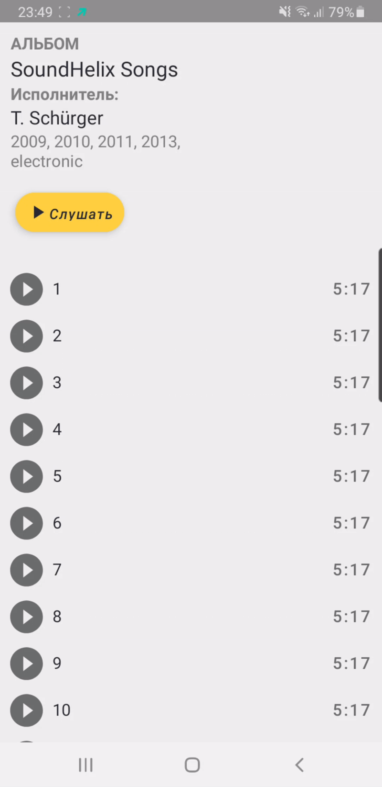

## MediaPlayer - мини-проект по работе с Android MediaPlayer.

**Цель:** изучение и практическое применение API MediaPlayer для воспроизведения аудио, а также работа с удалённым JSON.

**Что реализовано:**
- UI по аналогии «Яндекс Музыки»
- Загрузка данных альбома по JSON (OkHttp, парсинг Gson)
- Экран с информацией об альбоме и списком композиций (RecyclerView)
- Воспроизведение треков через MediaPlayer
- Логика воспроизведения по аналогии с веб-версией «Яндекс Музыки»: play/pause, автопереход к следующему треку, циклическое воспроизведение после последнего
- Корректное переиспользование ViewHolder без потери состояния (RecyclerView)

**Демонстрация:**

  

[Скриншоты](Screen-video)

**Стек:** Kotlin, MediaPlayer, OkHttp, Gson, RecyclerView.
